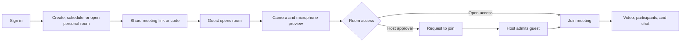

<div align="center">
  
  <h1>Baithak</h1>
  <p><strong>A welcoming place for your video meetings.</strong></p>
  <p>Start a call, plan one for later, or share a personal room link — from desktop or mobile.</p>

  <p>
    <a href="https://baithak-ten.vercel.app/">Open the live app</a>
    · <a href="#getting-started">Run it locally</a>
    · <a href="#features">Explore features</a>
  </p>

  <p>
    
    
    
    
  </p>
</div>

---

## About Baithak

Baithak is a video meeting and collaboration app built with Next.js. Its dashboard brings meeting creation, joining, scheduling, personal rooms, meeting history, and recordings together in one place. Meetings use Stream Video for real-time calls, while Clerk handles sign-in.

The interface uses a dark, responsive layout. On phones, key destinations are available from a bottom navigation bar, with the rest of the workspace in the menu. Baithak can also be installed as a Progressive Web App (PWA) from a supported browser.

## Features

### Create and join meetings

- **Start an instant meeting** and go straight to the camera and microphone setup.
- **Create a link for later** and copy its invitation link or meeting code.
- **Schedule a meeting** with a title, date, and time; share the generated meeting link.
- **Join with a code or link.** Baithak checks that the meeting exists before opening it.
- **Preview your camera and microphone** before joining.

### Host-controlled access

- Hosts can keep a room in **approval required** mode or turn on **open access**.
- In approval mode, guests request to join and wait for the host to admit them.
- Hosts can approve or deny requests from the meeting’s access panel.
- Personal room guests also request access by default; the host manages entry in the room.

### In the meeting

- Use Stream’s call controls for meeting audio and video, and leave the call when you’re done.
- Switch between an adaptive participant grid and speaker-focused layout.
- Open the participant list, view joining information, and copy the meeting code or link.
- Send and receive messages in the in-meeting chat.
- Hosts can review pending access requests and change the room’s access setting.

### Keep meetings organized

- **Upcoming meetings** shows scheduled calls and provides a shortcut to schedule another.
- **Previous meetings** lists ended calls so you can revisit a room or copy its link.
- **Recordings** lists and plays saved recordings available from Stream.
- **Personal room** gives each user a reusable room code and invitation link.

### Mobile and installable app

- Responsive dashboard, navigation, meeting setup, and call layouts adapt to smaller screens.
- Install Baithak from a supported browser and launch it in a standalone app window.
- The service worker caches the offline fallback and app assets as they are visited. When offline, Baithak shows an offline page; joining and hosting meetings still require an internet connection.

## App pages

| Page | Path | What it’s for |
| --- | --- | --- |
| Home | `/` | Start or schedule a meeting, create a reusable link, or join with a code. |
| Upcoming | `/upcoming` | Find scheduled meetings and schedule another. |
| Previous | `/previous` | Review ended meetings. |
| Recordings | `/recordings` | Browse saved meeting recordings. |
| Personal room | `/personal-room` | View and use your permanent room link. |
| Meeting | `/meeting/[id]` | Preview devices, request or enter the room, and meet. |
| Sign in / sign up | `/sign-in`, `/sign-up` | Authenticate with Clerk. |
| Offline | `/offline` | Fallback page shown when a page cannot load without a connection. |

The workspace and meeting pages require a signed-in user. Meeting routes still apply room-level access rules before a guest can join.

## How a meeting works



## Built with

| Area | Tools |
| --- | --- |
| Web app | Next.js 15 App Router, React 19, TypeScript |
| Styling | Tailwind CSS, custom responsive styles, Lucide icons |
| Authentication | Clerk (`@clerk/nextjs`) |
| Video meetings | Stream Video React SDK and Node SDK |
| UI primitives | Radix UI, with project components |
| PWA | Web app manifest and a hand-written service worker |
| Hosting | Configured for deployment on Vercel; also runs with Next.js hosting |

## Getting started

### Prerequisites

- Node.js 20 or newer and npm.
- A Clerk application for authentication.
- A Stream application with Video enabled.

### 1. Install dependencies

```bash
npm install
```

### 2. Configure environment variables

Create a `.env.local` file in the project root:

```dotenv
# Clerk — use the keys from your Clerk application
NEXT_PUBLIC_CLERK_PUBLISHABLE_KEY=pk_test_replace_me
CLERK_SECRET_KEY=sk_test_replace_me
NEXT_PUBLIC_CLERK_SIGN_IN_URL=/sign-in
NEXT_PUBLIC_CLERK_SIGN_UP_URL=/sign-up

# Stream — use your Stream application credentials
NEXT_PUBLIC_STREAM_API_KEY=replace_me
STREAM_SECRET_KEY=replace_me

# Public origin used to build shareable meeting links
NEXT_PUBLIC_BASE_URL=http://localhost:3000
```

Keep secret keys private. Do not commit `.env.local` or expose `CLERK_SECRET_KEY` or `STREAM_SECRET_KEY` in client-side code. For production, set the same variables in your hosting provider and set `NEXT_PUBLIC_BASE_URL` to the public app URL.

### 3. Start the development server

```bash
npm run dev
```

Open [http://localhost:3000](http://localhost:3000), sign in, and create a meeting. For production:

```bash
npm run build
npm run start
```

Run the configured linter with:

```bash
npm run lint
```

## Configuration notes

- Configure Clerk’s sign-in and sign-up redirect URLs to match the app’s `/sign-in` and `/sign-up` routes.
- Configure the Stream application for video calling and allow your local and deployed app origins where required by your Stream settings.
- The app creates and uses a dedicated Stream call type named `baithak`. Its server actions handle user tokens, personal room codes, and host admission controls.
- Meeting recording playback depends on recordings being available from Stream for the relevant call.
- PWA installation and service workers require a secure context (HTTPS in production; `localhost` is supported for local development).

## Project structure

```text
app/
  (auth)/                 Clerk sign-in and sign-up pages
  (root)/(home)/          Authenticated dashboard and meeting lists
  (root)/meeting/[id]/    Meeting route
  offline/                Offline fallback page
  globals.css             Global styles and video layout adjustments
  layout.tsx              App metadata, Clerk provider, and PWA registration
actions/                  Server actions for Stream tokens, rooms, and access
components/               Dashboard, meeting, navigation, and UI components
constants/                Shared navigation and app constants
hooks/                    Meeting, access, and toast hooks
lib/                      Meeting code and shared utilities
providers/                Stream Video client provider
public/
  icons/                  Baithak app icons
  manifest.webmanifest    Install and app display metadata
  sw.js                   Service worker and offline navigation fallback
```

## Live app

[baithak-meet.vercel.app](https://baithak-meet.vercel.app/)